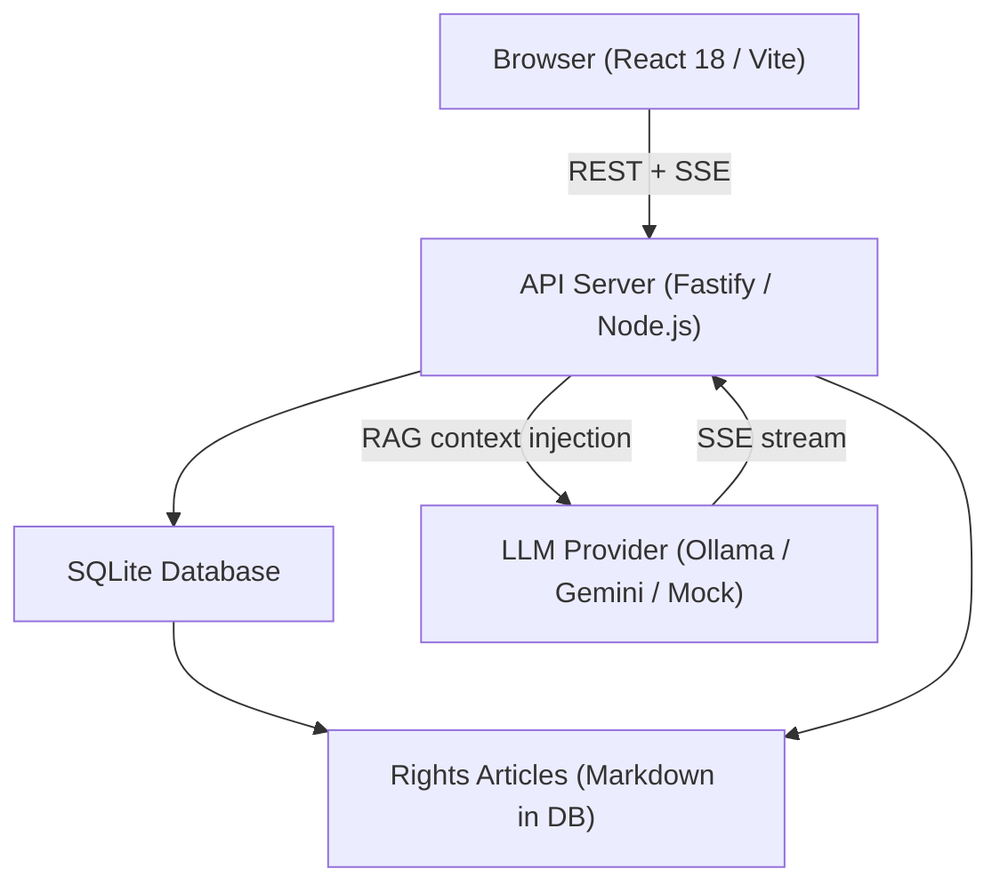

# DoorSpeaks — Product Specification

**Version:** 1.0.0 MVP  
**Date:** 2025  
**Status:** Phase 2 — MVP

---

## 1. Product Vision

DoorSpeaks is Bangalore's tenant-first rental transparency platform — the "Glassdoor for landlords and rental properties". Tenants in Bengaluru face a severe information asymmetry: landlords know the market, the law, and their own track record. Tenants do not. DoorSpeaks redresses this by aggregating verified tenant experiences, educating tenants on their rights under the Karnataka Rent Act 1999, and giving them data-driven tools to negotiate fairly.

**Tagline:** Know before you sign.

---

## 2. Personas

| Persona | Description |
|---------|-------------|
| **The Relocator** | IT professional moving to Bangalore from another city; no local network; vulnerable to deposit exploitation |
| **The Renewal Negotiator** | Existing tenant whose landlord wants to increase rent; needs market data |
| **The Deposit Claimant** | Tenant whose landlord is refusing to return deposit after move-out |
| **The First-Timer** | College student or fresh graduate renting for the first time; unaware of rights |
| **The Researcher** | Journalist, housing NGO worker, or policy researcher analysing Bangalore rental market |

---

## 3. Architecture



---

## 4. Data Model

### Landlord
```typescript
{
  id: string;
  name: string;
  localities: string[];          // e.g. ["Koramangala", "HSR Layout"]
  avgRating: number;             // 1-5, computed
  reviewCount: number;
  badges: string[];              // "Verified", "Prompt Deposit Returner", "Rated by 5+"
  createdAt: string;
}
```

### Property
```typescript
{
  id: string;
  landlordId: string;
  locality: string;
  bhk: number;
  address: string;               // Approximate only, never exact
  lat?: number;
  lng?: number;
}
```

### Review
```typescript
{
  id: string;
  landlordId: string;
  propertyId?: string;
  locality: string;
  bhk: number;
  rentPerMonth: number;
  tenancyStart: string;          // ISO date
  tenancyEnd?: string;
  ratings: {
    maintenance: number;         // 1-5
    depositReturn: number;
    privacyRespect: number;
    rentIncreaseFairness: number;
    communication: number;
  };
  depositAmount: number;
  depositReturned: number;
  freeText: string;
  anonymous: boolean;
  wouldRentAgain: boolean;
  moderationStatus: 'pending' | 'approved' | 'rejected';
  isDemo: boolean;
  createdAt: string;
}
```

### Locality
```typescript
{
  id: string;
  slug: string;
  name: string;
  zone: string;
  rentRanges: { bhk: number; min: number; max: number }[];
  typicalDepositMonths: { min: number; max: number };
  metroLine?: string;
  metroStation?: string;
  lat: number;
  lng: number;
  description: string;
}
```

### RightsArticle
```typescript
{
  id: string;
  slug: string;
  title: string;
  category: string;
  content: string;               // Markdown
  officialLinks: string[];
  needsLawyerVerification: boolean;
}
```

### ChatMessage
```typescript
{
  role: 'user' | 'assistant';
  content: string;
}
```

### DepositCheckRequest / Result
```typescript
// Request
{
  monthlyRent: number;
  depositAsked: number;          // In rupees
  depositAskedMonths?: number;
  propertyType: 'residential' | 'commercial';
  locality: string;
  leaseLength: number;           // In months
  isRegistered: boolean;
  maintenanceCharge: number;
}

// Result
{
  verdict: 'Typical' | 'High' | 'Potentially excessive';
  depositMonths: number;
  norm: { min: number; max: number };
  explanation: string;
  legalContext: string;
  negotiatingPoints: string[];
  redFlags: string[];
  documentChecklist: string[];
}
```

---

## 5. API List

| Method | Path | Description |
|--------|------|-------------|
| GET | /api/health | Health check |
| GET | /api/landlords | Search/list landlords |
| GET | /api/landlords/:id | Landlord detail |
| POST | /api/reviews | Submit a review |
| GET | /api/reviews | List reviews (by landlord) |
| POST | /api/deposit-check | Deposit legality check |
| GET | /api/rights | List rights articles |
| GET | /api/rights/:slug | Single rights article |
| POST | /api/chat | AI chat (SSE stream) |
| GET | /api/localities | List localities |
| GET | /api/localities/:slug | Locality detail |
| POST | /api/reports | Report a review/landlord |
| GET | /api/admin/reviews | Moderation queue (ADMIN_TOKEN) |
| PATCH | /api/admin/reviews/:id | Approve/reject review |

---

## 6. Roadmap

### Phase 1 — Research (Complete)
- Bangalore rental market research
- Karnataka Rent Act 1999 analysis
- Locality dataset compilation
- Tech stack decision

### Phase 2 — MVP (Current)
- Landlord search and reviews
- Deposit legality checker
- Tenant rights hub (12 articles)
- AI chat with mock/Ollama/Gemini
- Locality intelligence
- Rent fairness estimator
- Agreement red-flag scanner
- Deposit demand letter generator
- Language toggle (EN/KN/HI)

### Phase 3 — Verification & Maps
- Lease upload for review verification
- Leaflet map view of localities and properties
- Landlord response to reviews
- Rent Court process guide with form templates

### Phase 4 — Scale
- Multi-city expansion (Chennai, Hyderabad, Pune)
- Mobile app (React Native)
- Landlord portal (opt-in)
- API for housing NGOs and journalists

---

## 7. Risks

| Risk | Likelihood | Mitigation |
|------|-----------|------------|
| Defamation claims from landlords | Medium | Reviews moderated; defamation-safe disclaimer; takedown flow |
| PII leakage in reviews | Medium | Server-side regex filter blocking phone numbers and Aadhaar-format numbers |
| LLM hallucinating legal advice | High | "Not legal advice" banner; system prompt instruction; sources shown |
| Data quality / fake reviews | Medium | Moderation queue; rent-agreement upload verification (Phase 3) |
| Incorrect deposit norms | Low | Marked as market norms, not statutory caps; lawyer-verification flag |

---

## 8. Legal Disclaimer

DoorSpeaks is not a law firm and does not provide legal advice. All content, including rights articles and AI chat responses, is for informational purposes only and may not reflect the most current legal developments. Reviews are opinions of individual users. Landlords and property managers may request review removal via the report flow. Deposit norm data is based on market observations and is not a statement of law. Always consult a qualified advocate for matters involving legal rights and obligations.

The Karnataka Rent Act 1999 applies to residential properties. Many properties in Bangalore are outside rent control jurisdiction. This platform does not make representations about individual properties.
